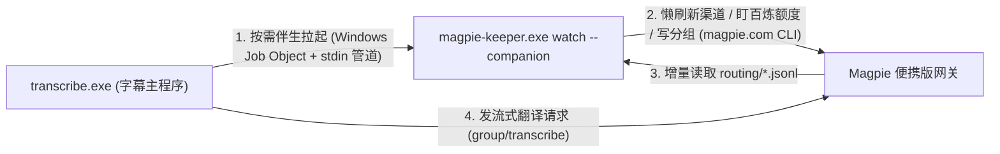
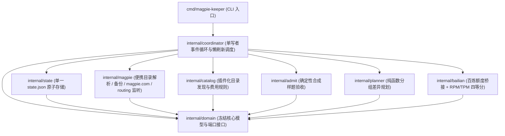

# Magpie-Keeper（2026 Agent 时代事件驱动架构版）架构与协议规格文档

> 本文档是 **Magpie-Keeper** 的架构边界与外部协议参考文档。当前实现细节以仓库源码与自动化测试为准；涉及 Magpie 兼容协议、目录适配器、合成验收规则或百炼免费试用池协议调整时，须同步更新本文档。

---

## 1. 定位、伴生联动与架构哲学



### 核心设计原则

1. **体验零摩擦，架构零耦合**：
   - **默认无感伴生模式（`watch --companion`）**：用户平时完全不需要手动跑维护命令，也不需要折腾 Windows 任务计划程序。只要在 `transcribe` 的 `config.json` 填上 `keeper_bin`，每次右键转字幕时 `transcribe` 会顺手后台静默拉起 `magpie-keeper watch --companion`；任务结束关闭其 `stdin` 管道（外加 Windows Job Object 双重兜底），`magpie-keeper` 立即优雅收尾退出，**平时零常驻进程、零内存占用**。
   - **独立工具契约**：与 `transcribe` 分目录、零代码/零数据库/零锁共享；唯一契约是 Magpie 分组名（默认 `group/transcribe` 与 `group/transcribe-paid`，可选开启 `review` 角色）。平时也可独立手动运行 `status`、`sync`、`sync-trial`、`watch`。
2. **Single-Writer Coordinator（单写者事件驱动模型）**：
   - 彻底抛弃旧版多个后台线程抢 `RLock` 写 7 个 JSON 文件的混乱结构。
   - 内部采用经典的 **Actor / 单写者协调器（Coordinator）**：所有读取/探测/监控源（普通渠道懒刷新定时器、百炼额度轮询器、`routing/*.jsonl` 增量监听、验收执行器）通过 Go Channel 上报事件；**只有唯一的 Coordinator 串行写 `magpie.com` 和 `data/state.json`**，从根源消灭竞态、锁死和半提交损坏。
3. **契约先行 + 插件化适配器（Multi-Agent & Future-Proof）**：
   - `CatalogAdapter`（模型目录发现）、`QuotaProvider`（云端免费额度探测）、`Admitter`（模型合成质检）均为窄端口接口；未来接入新聚合商或替换百炼官方 OpenAPI，只需新增单个适配器文件。
   - 相比旧版大瘦身：从 3 角色（6 组 + 底层型号互不重叠并查集优化）精简为 **1～2 角色**；验收改为 **3 道确定性合成英译中样题**（零额外裁判模型开销）；状态收拢为单一 `data/state.json` + 用户配置 `data/channels.json`。

---

## 2. 技术栈、依赖 DAG 与目录结构

- **语言**：Go 1.24+（纯 Go 编译单文件 `magpie-keeper.exe`），依赖 `cobra` + `log/slog` + 标准库 `net/http`/`os/exec`/`encoding/json`。
- **可选百炼额度桥接**：仅在开启百炼免费试用池时，由 `internal/bailian` 通过 stdin/stdout 管道调用极简独立的 `scripts/bailian-quota-bridge.mjs`（约 70 行 Node.js ESM 脚本，对接本机已安装官方 `bailian-cli 2.7.2` 内部只读接口）。若关闭百炼试用池，全程零 Node.js 依赖。



### 包级分层布局（概览）

> 以下只记录模块分层与职责边界；各包内具体的 `.go` 文件拆分以仓库当前源码为准。

| 路径 | 职责边界 |
| --- | --- |
| `AGENTS.md` / `go.mod` | 仓库维护规范、依赖约束与验证命令 |
| `cmd/magpie-keeper/` | CLI 入口、Cobra 子命令装配、信号处理与 `--companion` stdin-EOF 监听 |
| `internal/domain/` | 冻结核心模型与窄端口接口（仅 Go 标准库，零外部依赖） |
| `internal/config/` | `data/channels.json` 加载与校验 |
| `internal/state/` | 单一 `data/state.json` 原子读写与日预算扣减 |
| `internal/magpie/` | 便携目录解析（含真实 Magpie JSON 兼容）、`providers.json` 自动备份、`magpie.com` 封装、`data/routing/*.jsonl` 增量监听 |
| `internal/catalog/` | 插件化 `CatalogAdapter`（`registry` / `openrouter` / `vercel` / `vllm-sr`）与费用/价格过滤 |
| `internal/admit/` | 3 道内置合成英译中样题与流式 SSE 确定性验收 |
| `internal/planner/` | 100% 纯函数分组差异规划、人工保留尊重（`manual_hold`）与自底向上变更序列 |
| `internal/bailian/` | 百炼额度桥接调用、`/api/v1/models/limits` 查询与 RPM/TPM 四等分试用池决策 |
| `internal/coordinator/` | Single-Writer Actor：串行消费各类事件，安全更新 Magpie 与 `data/state.json` |
| `scripts/` | 可选 `bailian-quota-bridge.mjs`（调用本机 `bailian-cli` 查询全量免费额度） |
| `data/` | 运行时目录（仅模板 `channels.example.json` 入 Git；`channels.json`、`state.json`、`backups/` 不入库） |

---

## 3. 冻结核心契约（`internal/domain`）

```go
package domain

import "context"

// 1. Magpie 网关操作端口
type MagpieGateway interface {
    ReadRegistry(ctx context.Context) (RegistrySnapshot, error)
    BackupRegistry(ctx context.Context) (backupPath string, err error)
    ExecCLI(ctx context.Context, args ...string) error
    ListServedModels(ctx context.Context) ([]string, error) // GET /v1/models
}

// 2. 插件化模型目录适配器
type CatalogAdapter interface {
    Name() string
    Discover(ctx context.Context, provider Provider, rule ProviderRule, served map[string]bool) ([]Candidate, error)
}

// 3. 确定性模型验收端口
type Admitter interface {
    Evaluate(ctx context.Context, member string) (AdmissionResult, error)
}

// 4. 云端免费额度探测端口（今天接 bailian-cli 桥接，未来可直接换官方 OpenAPI）
type QuotaProvider interface {
    QueryFreeQuotas(ctx context.Context) ([]QuotaObservation, error)
    QueryModelLimits(ctx context.Context, model string) (RateLimits, error)
}

// 5. 路由日志实时事件
type RouteAlert struct {
    ProviderID string
    Model      string
    Kind       string // "quota_exhausted" | "account_credit" | "permission_denied"
}
```

---

## 4. 本机便携版 Magpie 对接协议（必须严格遵守）

### 4.1 便携目录与人工开关尊重

- 校验 `<magpie_dir>/.portable`、`<magpie_dir>/magpie.com`、`data/providers.json` 存在；读 `data/settings.json` 核对端口（默认 `3425`）与 `magpie_url` 一致。
- 合并 `data/providers.json` 与 `data/plugin-providers.json`（插件 `signedIn == false` 视同停用）及 `data/cache/models/<id>.json`（须校验 `base` 与当前 endpoint 一致）。
- **真实 Magpie JSON 格式兼容**（对应 `internal/magpie/registry_parse.go`、`registry_flex.go` 与 `TestReadRegistryRealMagpieFormats`）：
  - 供应商 `models` 兼容逗号分隔字符串、字符串数组及 `plugin-providers.json` 中的对象数组（含 `id` 与内嵌元数据）；URL、限流与列表字段兼容 `chat`/`api`/`base`/`baseAPI`/`responses`、`rpm`/`maxRPM`、`list`/`listOff`。
  - 分组字段兼容 `id`/`name`、`models`/`members`、`stays`/`affinity`、`weight`/`weights`，且 `group.off` 同时兼容布尔开关与被禁用成员数组（`[]string`）。
- **不可用过滤**：Provider 级 `off` / `noModels` / `signedIn == false`；Model 级位于 `modelsOff`、`_models[name].decides == true`、输出模态不含 `text` 或 `type != "language"`。
- **尊重人工干预**：曾由本工具加入的成员若被用户手工从分组移除、放入 `group.off` 或对应分组设为 `hidden == true`，将其记录为 `manual_hold`，**永不强行加回**。

### 4.2 `magpie.com` CLI 命令规范

所有写操作必须走 `<magpie_dir>/magpie.com`（隐藏窗口，`provider refresh` 超时 30s，其余 5s）：

| 动作 | 命令参数 |
| --- | --- |
| 刷新供应商目录 | `provider refresh <id>` |
| 暴露模型 | `provider models <id> +<model>` |
| 新建百炼试用子通道 | `provider add <id> id=<id> chat=<url> key=<key> models=<model> free=yes list=off header.X-Transcribe-Trial-Model=<model>` |
| 启停通道 / 限流 | `provider on <id>` / `provider off <id>` / `provider rpm <id> <n>` |
| 新建/修改分组 | `group add <name> models=<m1,m2> routing=<order\|weight\|fast> stays=off` / `group set <name> [models-=<...>] [models+=<...>] [routing=<...>] [stays=off] [weight=<m=1,...>]` |

**四条硬规矩**：
1. **Magpie 禁止将分组清空**（至少保留 1 个成员）；摘除试用组最后一个成员前先 `provider off` 停用该通道（或先挂已停用的模板占位成员）。
2. **Magpie 同源去重冷却**：相同 `chat + key + headers` 共享冷却，因此百炼试用子通道必须带 `header.X-Transcribe-Trial-Model=<model>` 隔离冷却键。
3. **写前必备份**：每次变更前自动备份 `providers.json` 到 `data/backups/<timestamp>/providers.json`。
4. **自底向上写入**：先写供应商子组 → `transcribe-free` / `transcribe-paid` → 最后写顶层主组 `transcribe`（`routing=order`，顺序 `[group/transcribe-free, group/transcribe-paid]`）；`transcribe-paid` 绝不能为空或混入免费/试用成员。

### 4.3 推荐分组拓扑（单/双角色极简结构）

```text
group/transcribe (routing=order, stays=off)
├── group/transcribe-free (routing=weight; review 角色用 fast)
│   ├── group/transcribe-trial (routing=order)             # 百炼免费试用子通道（最多 3 个）
│   └── group/transcribe-<free-supplier> (routing=order)   # 如 openrouter-free / vercel-free / zen-free
└── group/transcribe-paid (routing=weight; review 角色用 fast)
    └── group/transcribe-<paid-supplier> (routing=order)   # 如 bailian / qiniu-paid / copilot
```

---

## 5. 配置文件 `data/channels.json`

```json
{
  "magpie_dir": "D:\\Program Files\\magpie",
  "magpie_url": "http://127.0.0.1:3425/v1",
  "magpie_key": "magpie-transcribe",
  "roles": ["transcribe"],
  "channel_sync_interval": "6h",
  "excluded_providers": [],
  "max_evaluations_per_cycle": 2,
  "max_evaluations_per_day": 6,
  "cooldown_seconds": 3600,
  "bailian_trial": {
    "enabled": true,
    "paused": false,
    "workspace_id": "your-workspace-id",
    "template_provider": "transcribe-bailian-trial",
    "commercial_provider": "transcribe-bailian",
    "max_active_models": 3,
    "refresh_interval": "60s",
    "excluded_models": []
  },
  "providers": {
    "transcribe-openrouter-free": {
      "adapter": "openrouter",
      "include": ["*:free"],
      "billing": ["free"],
      "max_candidates": {"free": 5}
    },
    "vercel": {
      "adapter": "vercel",
      "preferred": ["openai/gpt-6-luna", "google/gemini-3.8-flash"],
      "price_exceptions": ["openai/gpt-6-luna", "google/gemini-3.8-flash"],
      "max_input_usd_per_million": 2.0,
      "max_output_usd_per_million": 10.0,
      "billing": ["free", "commercial"],
      "max_candidates": {"free": 2, "commercial": 3}
    },
    "transcribe-bailian": {
      "adapter": "registry",
      "preferred": ["qwen3.8-max", "deepseek-v4.1-flash", "qwen3.8-flash"],
      "price_exceptions": ["qwen3.8-max", "deepseek-v4.1-flash", "qwen3.8-flash"],
      "billing": ["commercial"],
      "max_candidates": {"commercial": 4}
    }
  }
}
```

---

## 6. 多渠道发现与确定性合成验收

### 6.1 目录适配器与费用规则

先调 `GET <magpie_url>/v1/models` 获取当前网关实际暴露成员（若 `has_more == true` 中止）：
- `registry`：结合 `plugin-providers.json`、`cache/models/<id>.json` 与 `/v1/models`；插件 `free == true` 或已知免费模型判 `free`，其余 `commercial`。
- `openrouter`：`GET https://openrouter.ai/api/v1/models`，`id` 以 `:free` 结尾且 `pricing.prompt`/`completion` 均为 `"0"`/`"0.0"` 判 `free`。
- `vercel`：`GET https://ai-gateway.vercel.sh/v1/models`（与本地可用取交集），全价为 0 判 `free`；商业模型仅当每百万 token 输入 `<= 2` 美元且输出 `<= 10` 美元（或位于 `price_exceptions`）才允许新验收。
- `vllm-sr`：`GET https://app.vllm-sr.ai/pt/api/info` 提取 `routes_to` 列表，`vllm-sr/vllm-sr/auto` 判 `free` 且仅放行至主翻译组（需 Magpie 透传 `X-Vsr-Selected-Model`）。

### 6.2 确定性合成样题验收（3 题，零裁判开销）

所有验收仅发内置英文合成样题（流式 `POST /v1/chat/completions`，`X-Magpie-Response-Model: member`，`X-Magpie-Session: keeper-admit-<uuid8>`，`max_tokens: 4096`，`response_format: json_object`，超时 120s）：
1. **否定 + 术语 + 数字**：`["Do not disable the cache.", "It stores 12 results."]`（人工术语 `cache -> 缓存`）→ 校验合法 JSON 无重复键、ID 齐全、数字 `{12}` 完整、含“缓存”、未原样照抄。
2. **条件跨屏拆分 + 数字**：同句 2 片 `["If the temperature exceeds 35 degrees,", "stop the pump."]` → 校验 ID 齐全、数字 `{35}` 完整、两片非空且无整句重复。
3. **8 句批处理 + 数字对比**：9 个片段含 `3 / 30 / 12` 与 `cache` → 校验全 9 片 ID 齐全、数字 `{3, 30, 12}` 完整、含“缓存”、无跨句长重复、`finish_reason == "stop"`。

缓存与限额：
- 缓存键：`SHA-256(endpoint_key_hash + model + suite_version)`，已通过且配置未变直接复用；
- 日预算在发起推理**前**扣减并落盘 `state.json`（崩溃不退还）；
- 瞬态错（408/429/5xx/超时）冷却 5 分钟；拒绝或质检不通过冷却 `cooldown_seconds`（默认 1 小时）；记录 `duration_ms` 与 `reasoning_tokens == 0`。

---

## 7. 百炼免费试用额度动态池

1. **前置模板与子通道派生**：
   - 依赖 Magpie 中预配的停用模板 `transcribe-bailian-trial`（`off: true`，URL `https://<workspace_id>.cn-beijing.maas.aliyuncs.com/compatible-mode/v1`）；
   - 按模型名派生子通道 `transcribe-bailian-trial-<sha256(model)[:12]>`，最多同时激活 **3 个** 合格模型挂入 `group/transcribe-trial`。
2. **免费额度查询（`scripts/bailian-quota-bridge.mjs`）**：
   - Go 端读 `~/.bailian/config.json`（或 `BAILIAN_CONFIG_DIR`）的 `active_config` AK/SK，仅经 **stdin 管道**传给 `node scripts/bailian-quota-bridge.mjs <bailian_cli_pkg_dir>`（`TZ=Asia/Shanghai`，通过 `bl.cmd` 定位同级 `node_modules/bailian-cli` 并验证版本 `2.7.2`）；
   - 仅放行 3 个只读控制台 API（`listFoundationModels`、`queryFreeTierQuota`、`queryFreeTierOnlyStatus`），复用内存临时令牌调 `usageFree.run({flags: {all: true, sort: 'expires'}})`；
   - 可用条件：`type == "Text"`、`0 < remaining <= total`、`remainingPercent` 合法、到期日 `expires > 北京当前日期`（到期当天即停用）；按 `(到期日升序, 剩余量降序, 模型名升序)` 排序优先消耗快过期额度；失败则指数退避（60s～300s）。
3. **共享 RPM / TPM 四等分保护**：
   - 查询 `GET https://<workspace_id>.cn-beijing.maas.aliyuncs.com/api/v1/models/limits?model=<model>&page_size=100`（Bearer 百炼 API Key）；
   - 将工作空间聚合 RPM（含 `workspace_tpm / 36864` 折算）均分 **4 份**（1 份留商业通道 `transcribe-bailian`，最多 3 份给并发试用子通道），经 `magpie.com provider rpm` 同步下发，防止挤爆主账号。
4. **路由日志实时下线（`internal/magpie/tailer.go`）**：
   - 每秒增量读取 `<magpie_dir>/data/routing/*.jsonl`，对 `transcribe-bailian-trial-*` 的 `tries[]`：
     - `error` 含 `free quota exhausted` 或 (`free tier` 且 `exhaust`) → 立即摘除并 `provider off`、触发补位；
     - `fail == "credit"` → 立即下线全部试用子通道；
     - `status == 401 || 403` → 立即下线该子通道。

---

## 8. 运行模式与 CLI 命令

| 命令 | 说明 |
| --- | --- |
| `magpie-keeper watch [--companion]` | **核心常驻/伴生模式**：启动时检查 `last_channel_sync_at`（超过 `channel_sync_interval` 才懒刷新普通渠道）；同时立即同步百炼免费额度并每秒监听 `routing/*.jsonl`。带 `--companion` 时额外监听 `stdin` EOF：父进程 `transcribe` 退出关闭管道即优雅停机。 |
| `magpie-keeper status` | 只读查看各目标分组当前成员、费用归属、上次同步时间与百炼试用状态。 |
| `magpie-keeper list-candidates` | 只读预览各渠道候选与准入决策。 |
| `magpie-keeper sync [--apply] [--if-stale 6h] [--dry-run]` | 发现并验收普通渠道候选；`--dry-run` 仅打印差异计划，`--apply` 备份并写入 Magpie。 |
| `magpie-keeper sync-trial` | 单次刷新百炼免费试用额度并更新 `group/transcribe-trial`。 |
| `magpie-keeper add-provider <id>` / `pause-trial` / `resume-trial` | 快速增删渠道配置与暂停/恢复百炼试用池。 |
